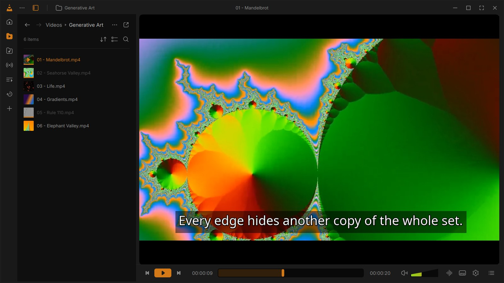
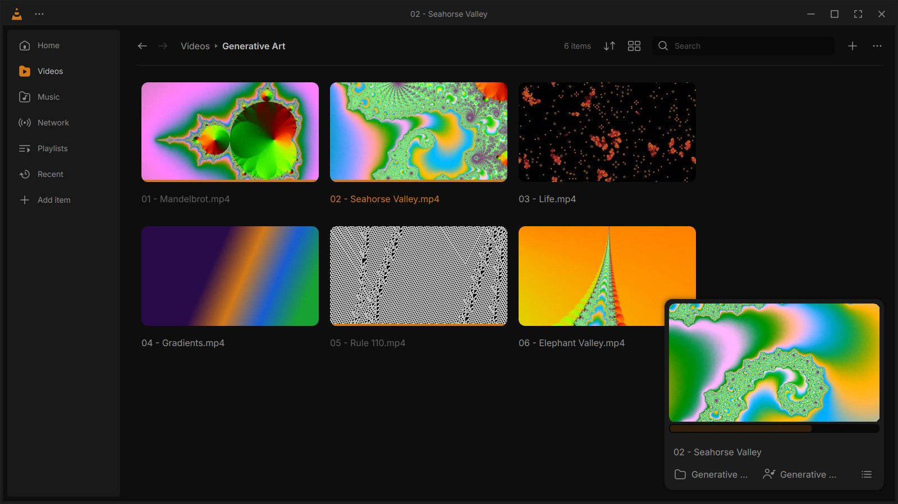
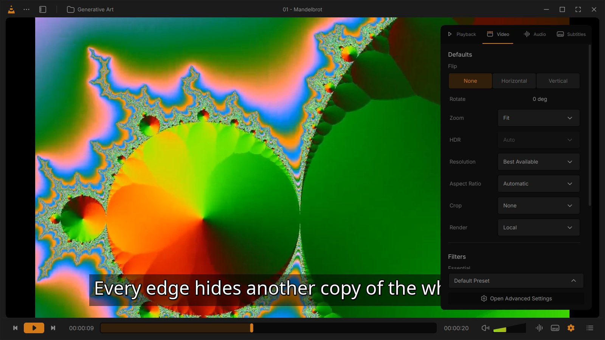

# VLC Redesign

I liked [Juxtopposed's VLC redesign](https://youtu.be/ERFeOgqk324) enough that I wanted to actually use it, so I
built it. The interface follows her [Figma file](https://www.figma.com/community/file/1691465999134370980) (colours,
sizes, icons, layouts) and libVLC does the playing, so it opens everything your normal VLC opens. Your normal VLC
stays as it is.



## Install

```
curl -fsSL https://raw.githubusercontent.com/nagasab221/vlc-redesign/main/install.sh | bash
```

Made on Linux Mint, should work on Ubuntu and Debian too. If you're missing VLC, PyQt5 or ffmpeg it installs them
(that's the only part that asks for your password). After that it's in the menu as VLC and under Open With when you
right click a video, and your normal VLC shows up as VLC Classic so you can tell them apart. It doesn't change your
default player.

Run the same command again to update. You can also clone the repo and run `./install.sh`, which runs it straight
from the clone.

## Uninstall

```
curl -fsSL https://raw.githubusercontent.com/nagasab221/vlc-redesign/main/install.sh | bash -s -- --remove
```

Your settings stay in `~/.config/vlc-redesign` in case you come back.

## What's in it

Pretty much everything from the video:

- One thin control bar with the thick seek bar, the cone shaped volume (goes up to 200%), and buttons for audio,
  subtitles, playback settings and the queue. Hover the seek bar for a preview frame, click the time to jump
  somewhere, click the duration to see time left.
- In fullscreen the bars only show up when you move the mouse to the top or bottom edge. Ctrl+\ does the same in a
  window.
- Side panels for tracks (and which speakers or headphones to use), playback/video/audio/subtitle settings, and
  queue/bookmarks/chapters. Subtitle sync has the timeline on the seek bar with buttons to nudge it.
- Save those settings as a preset for a show and it gets used for every episode in that folder.
- The library opens as a sidebar next to the video, or as a full window with a mini player. Videos, music (songs,
  albums, artists, genres), network streams, m3u lists, podcasts, radio, playlists, favourites and recently played.
  Watched stuff gets greyed out and Continue Watching remembers where you stopped.
- Add Subtitles can match a folder of .srt files to a whole season at once.
- Shortcuts you can change (global ones too), profiles, light and dark theme with accent colours, and Customize
  Player to drag the buttons around.
- Picture in picture, snapshots, recording a clip, Convert and Stream.





## Things to know

- Needs X11. Mint's Cinnamon session is X11, and on Wayland it runs through XWayland by itself. There the window
  is dragged by the app instead of the desktop (so no snapping to screen edges), and global hotkeys only fire
  while an X11 app has focus.
- Changing a filter like flip, sepia or the compressor makes the video blink for a second while libVLC restarts at
  the same spot. That's just how libVLC 3 does filters.
- Subtitle font, colour and size work on text subtitles (.srt and friends). Styled .ass subtitles (most anime)
  keep their own look until you change one of those, then they're shown as plain text in your style; the Embedded
  Sub Format toggle switches back. Subtitles from DVD and Blu-ray rips are pictures, so they can't be restyled.
- Reverse playback, HDR tone mapping and casting aren't possible with libVLC 3, so those options are greyed out.
- OpenSubtitles search opens their website, since their API needs your own key.

## Credits

Design and icons: "VLC Redesign" by Juxtopposed, [CC BY 4.0](https://creativecommons.org/licenses/by/4.0/).
Playback: libVLC by VideoLAN, through the bundled [python-vlc](https://github.com/oaubert/python-vlc) (LGPL).
Font: [Inter](https://github.com/rsms/inter) (OFL). Not affiliated with VideoLAN.

The code is MIT licensed.
